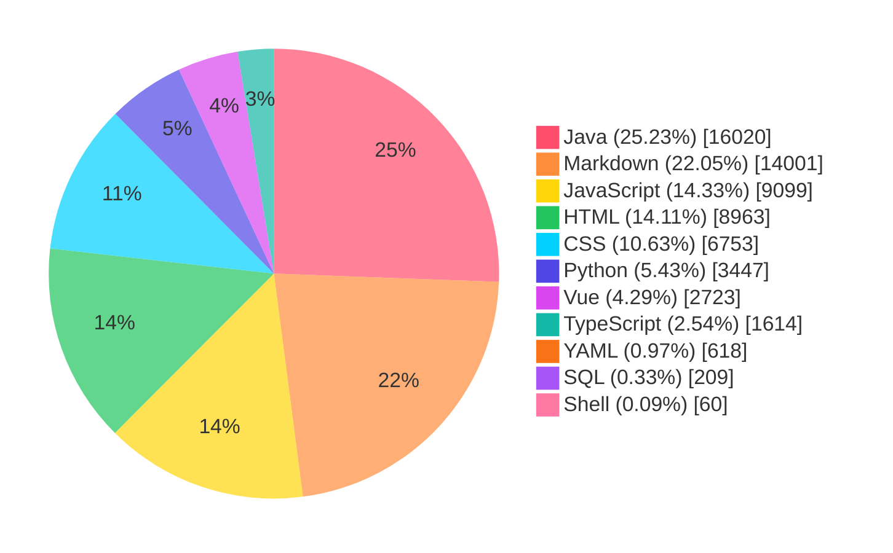

# 北化教学辅助系统

<p align="center">
  <strong>项目信息</strong><br />
  <a href="./LICENSE"></a>
  <a href="./README.md"></a>
  <a href="https://openjdk.org/projects/jdk/25/"></a>
  <a href="https://www.python.org/downloads/release/python-3110/"></a>
  <a href="https://github.com/TheBadRoger/BUCT-Teaching-Aids/commits/main"></a>
  <a href="https://github.com/TheBadRoger/BUCT-Teaching-Aids"></a>
  <br /><br />
  <strong>代码统计</strong><br />
  <a href="#项目统计"></a>
  <a href="#项目统计"></a>
  <a href="#项目统计"></a>
  <br /><br />
  <strong>CI状态</strong><br />
  <a href="https://github.com/TheBadRoger/BUCT-Teaching-Aids/actions/workflows/java-build.yml"></a>
  <a href="https://github.com/TheBadRoger/BUCT-Teaching-Aids/actions/workflows/java-tests.yml"></a>
  <a href="https://github.com/TheBadRoger/BUCT-Teaching-Aids/actions/workflows/python-build.yml"></a>
</p>

<!-- STATS_SECTION_START -->
## 项目统计

> 统计更新时间（UTC+8）：`2026-10-24 13:46:17`

### 核心统计

| 指标 | 数值 |
| :-- | --: |
| 代码总行数（非空行） | 63507 |
| Java 接口数 | 142 |
| Python 接口数 | 36 |
| Java 单元测试用例数 | 278 |
| Python 单元测试用例数 | 48 |

### 语言占比图


<!-- STATS_SECTION_END -->

## 开发框架简介

- 管理前端：Vue 3 + TypeScript + Vite + Pinia + Element Plus；保留随后端部署的 HTML/CSS/JavaScript 页面

- 后端：Java SpringBoot + Python Flask

- 数据库：MySQL - 持久化，Redis - 高并发情况下的中间缓存

## 工作进度

**后台管理系统：完成前后端分离**

- 已实现课程相关的大多数功能
- 实现AI智能批改实验报告，前后端均已实现。
- 打通教师/学生/课程后台管理页（列表、查看、新增、编辑、删除、导出）的前后端链路，详见 [admin_frontend_api_map.md](docs/api/admin_frontend_api_map.md)
- 新增 AI 背诵手册：上传 `.txt/.docx/.pdf` 学习资料，自动生成知识归纳、记忆口诀、必背要点、自测题（复用 polymas AI，前端见 `static/recitation/`）。

> 其余项目组的进度，以后就在这里加就行

## 项目文件结构

```text
apps/
  api/
    java/                  # Java Spring Boot 后端
    python/                # Python Flask 后端
    teacher-ai/            # 教师 AI Express 接口服务
  web/                     # 唯一 Vue 前端：学习端、管理端、AI 教学工具
Dockerfile                 # 全项目镜像构建（多阶段/多目标）
compose.yaml               # 唯一 Docker 整体部署入口
.env.example               # 部署变量模板（复制为 .env）
database/
  init/                    # 容器数据库初始化脚本
  manual/                  # 独立 SQL，按需人工执行
docs/
  api/                     # 接口文档及页面接口映射
  architecture/            # 后端架构说明
  deployment/              # Linux、Windows、Docker 部署说明
scripts/                   # 仓库工具及生成的统计数据
```

Java 的 `src/main/resources/static/` 和 Python 的 `static/`、`templates/` 保持在各自应用内，保留现有资源加载方式。各应用使用原有构建和启动命令，不引入新的工作区工具。旧路径对照和运行入口见 [目录说明](docs/project-layout.md)，全部文档见 [文档导航](docs/README.md)。

## AI 配置说明（polymas）

AI 批改、背诵手册等功能共用一个第三方 AI 平台 **polymas**。相关配置在
`apps/api/java/src/main/resources/application.properties` 的 `app.ai.polymas.*` 段，可通过环境变量 `POLYMAS_AUTH_KEY` 配置。

## 文档

|                   后端接口文档                   |                              后端部署方法                              |                     后端项目介绍                     |
| :----------------------------------------------: | :--------------------------------------------------------------------: | :--------------------------------------------------: |
|   [Java](docs/api/java_apidoc.md)   |      [Windows - Java](docs/deployment/java_deploy_win.md)       | [Java](docs/architecture/java_api_intro.md) |
| [Python](docs/api/python_apidoc.md) |   [Ubuntu Linux - Java](docs/deployment/java_deploy_linux.md)   | [Python](docs/architecture/python_api_intro.md) |
|                        -                         | [Ubuntu Linux - Python](docs/deployment/python_deploy_linux.md) | - |
|                        -                         |           [Docker](docs/deployment/docker_deploy.md)            | - |
