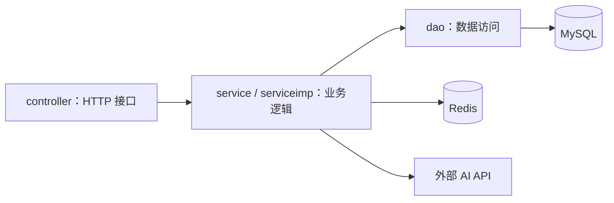

# Java 后端

| 项目 | 实现 |
| --- | --- |
| 运行与构建 | Java 25、Spring Boot 4、Maven |
| HTTP 与认证 | Spring MVC、Spring Security、Cookie Session |
| 数据访问 | Spring Data JPA、MySQL |
| 缓存 | Redis，课程访问数据定期写回 MySQL |
| AI 服务 | DeepSeek 教师 AI；polymas 批改与背诵手册 |
| 页面托管 | Java static 提供 Vue 构建产物与静态页面 |
| 测试 | JUnit、Spring Test、Testcontainers |

## 分层与业务

| 目录 | 内容 |
| --- | --- |
| `controller/` | 用户、机构、师生、课程、笔记、媒体、教参、学习统计与 AI 接口 |
| `service/`、`serviceimp/` | 服务契约与实现；教师 AI 实现为 `TeacherAIService` |
| `dao/`、`entities/`、`dto/` | 持久化访问、实体与传输对象 |
| `config/`、`utils/` | 安全、会话、缓存、配置与公共工具 |
| `resources/teacher-ai/` | 教师 AI 提示词与学科目录 |

## 接口与部署

| 范围 | 协议 |
| --- | --- |
| 普通业务 | `ApiResponse`，成功码为 `2000` |
| 教师 AI | `/api/teacher-ai/**`，使用 `success/data` JSON 和 SSE 事件 |
| 登录 | 后端将认证上下文保存至 Session，浏览器携带 `JSESSIONID` |
| Python 能力 | 独立 Flask 服务；浏览器分别访问 Java 与 Python，没有统一后端网关 |

接口参数见[Java 接口手册](../api/java_apidoc.md)，运行配置见[整体部署](../deploy.md)。
